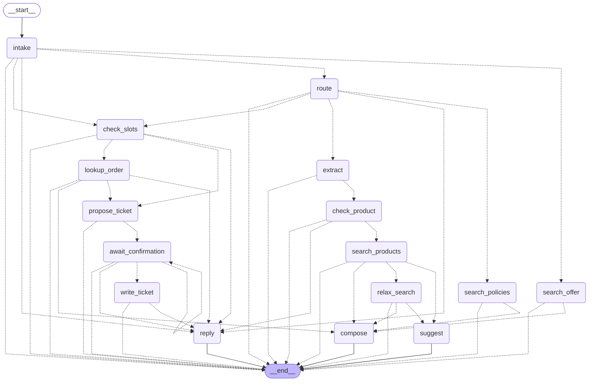

# Agent design (Phase 6)

A LangGraph state machine in which the LLM is used only at fuzzy steps and every loop has an explicit bound and exit. Decisions and their reasons: `docs/DECISIONS-phase6.md` (A1 to A16) and, for the offer after an empty search, `docs/DECISIONS-phase7.md` (D7.25 to D7.33). Code: `app/agent/`. This file is checked against the code: the node table and the diagram below are compared with the compiled graph by `tests/test_agent_design_doc.py`.

## 1. A conversation, a turn, a request

- A **conversation** is a LangGraph thread (`thread_id` = conversation id), kept by `InMemorySaver`. Slots the customer gave, the clarify counter and the failed-verification counter live in its state. Nothing is persisted across a process restart.
- A **turn** is one customer message. `Agent.turn(conversation_id, message)` runs the graph once and returns the reply. One turn is one traced request (one line in `logs/traces.jsonl`), including the turn that answers a confirmation.
- A turn that ends at the ticket confirmation is **paused** (`awaiting = ticket_confirmation`). The next message is delivered with `Command(resume=message, update={"steps": 0})`, never as a new input (a new input on a paused thread would only pause it again; checked). Every other turn is a fresh run from `START`.

## 2. The graph

<!-- graph:start -->

<!-- graph:end -->

### Nodes

`kind`: *rule* = deterministic code, *LLM* = a Gemini call, *tool* = reads or writes something. Every node adds 1 to `steps`.

<!-- nodes:start -->
| Node | Kind | Span | Targets | Bound |
|---|---|---|---|---|
| `intake` | rule | none | `route`, `check_slots`, `search_offer`, `reply` | an offer is valid for the next message only |
| `route` | LLM (router) | `router` | `extract`, `search_policies`, `check_slots`, `reply` | none |
| `extract` | LLM (extractor) | `extractor` | `check_product` | none |
| `check_product` | rule | none | `search_products`, `reply` | clarify at most 2 times |
| `search_products` | tool | `retrieval` | `relax_search`, `suggest`, `compose` | none |
| `relax_search` | tool | `retrieval` | `suggest`, `compose` | runs at most once per request |
| `suggest` | tool + rule | `retrieval` or `reply` | none | at most 4 Qdrant counts; asks, never searches |
| `search_offer` | tool | `retrieval` | `compose` | only from `intake`, only after an explicit yes |
| `search_policies` | tool | `retrieval` | `compose` | none |
| `check_slots` | rule | none | `lookup_order`, `propose_ticket`, `reply` | clarify at most 2 times; lookup disabled after 3 failures |
| `lookup_order` | tool | `order_lookup` | `compose`, `propose_ticket`, `reply` | none |
| `propose_ticket` | rule | `ticket_confirm` | `await_confirmation` | none |
| `await_confirmation` | rule (interrupt) | none | `await_confirmation`, `write_ticket`, `reply` | asks at most 2 times |
| `write_ticket` | tool | `ticket_confirm` | `reply` | none |
| `compose` | LLM (answer) + rule | `answer` or `reply` | none | none |
| `reply` | rule | `reply` | none | none |
<!-- nodes:end -->

`none` in Targets means the node ends the turn. Every node may also end the turn when the step cap is hit (section 3).

### The paths, by intent

- **smalltalk / out_of_scope:** `intake`, `route`, `reply` (3 steps). No tool, no LLM beyond the router. A fixed polite reply.
- **policy_question:** `intake`, `route`, `search_policies`, `compose` (4). No hit: a fixed "the shop has no information" reply, no LLM.
- **product_search:** `intake`, `route`, `extract`, `check_product`, `search_products`, [`relax_search`], `compose` or `suggest` (6 or 7). The longest legitimate path is **7**.
  - `check_product`: no `kind` and no `category` in the filters: ask what kind of item (`reply`), counted as a clarifying turn.
  - `search_products`: 0 hits and a relaxable constraint: `relax_search`. 0 hits and nothing to relax: `suggest`.
  - `relax_search`: hits: `compose`. Still 0 hits: `suggest`.
  - `suggest` (docs/DECISIONS-phase7.md, D7.25 and D7.32): counts in Qdrant, without any LLM, which constraints would have to go for there to be products. It tries each of `size`, `color`, `material`, `price` **alone, in that order**, and takes the first that leaves a count above 0 (it names only that one); if none does, it drops them **cumulatively** in the same order (size, size and color, ...) and takes the first step with a count above 0. At most 7 counts. `kind` (and category, in_stock) is never dropped. Found: a fixed question ("nothing matches; X blocks; N products if X goes; do you want to see them?"), no product listed, the turn ends and the offer is kept in the conversation. Not found: the fixed "nothing found" reply, as before.
- **The turn after an offer:** `intake` reads the message with the ticket's yes/no parser. An explicit yes: `search_offer`, `compose` (3 steps): the same search without the dropped constraints, answered like any search, with the first line "Không khớp hoàn toàn: khác ...". A message that is nothing but a refusal ("không", "thôi", "không cần đâu", `is_plain_decline`): `intake`, `reply` (2 steps), a fixed reply, no router, no search, no LLM (D7.33). Anything else, "không, cho mình xem áo khoác" included, is a new message for the router. In every case the offer is spent: it is valid for the next message only. Price is only ever offered, never dropped by the agent on its own.
- **order_status:** `intake`, `route`, `check_slots`, `lookup_order`, `compose` (5). Verified: the LLM writes the answer from the minimal order data. Not verified: the fixed refusal through `reply`.
- **create_ticket:** `intake`, `route`, `check_slots`, `lookup_order` (only when an order number is given), `propose_ticket`, `await_confirmation` (5 or 6, the turn ends paused). The next turn, `await_confirmation`, `write_ticket`, `reply` (3).
- **A follow-up turn** that gives the awaited email or order number: `intake` goes straight to `check_slots` and skips the router.

## 3. Every bound, and its exit

| Loop or risk | Bound | Exit when reached | Test |
|---|---|---|---|
| Clarifying turns for one request | **2** | product: search with what is known; order, ticket: a polite hand-off to staff. Never a third question | `tests/test_agent_bounds.py` |
| Filter relaxation | **1** retry, dropping the first present of `size`, `color`, `material`; never `kind`, `category`, price or `in_stock` | the reply says nothing matches all the constraints and names what was dropped; if still 0 hits, `suggest` counts and offers (below) or says "nothing found". It never loops | same |
| Offer after an empty search | **1** offer per empty search; counts only (at most 4), no search, no LLM; never drops `kind`; price only as the last step | the offer is a question: it changes nothing until an explicit yes, and it is valid for the next message only. A yes runs ONE search (`search_offer`); no second offer is made from it | `tests/test_agent_offer.py` |
| Failed verifications | **3** per conversation | order lookup is disabled for the rest of the conversation; the tool is not called again, even with correct credentials | same |
| Ticket confirmation | **2** asks | only an explicit yes writes a ticket; an unclear answer is asked once more, then the ticket is cancelled | same |
| Steps per turn | **8** (`max_steps`), LangGraph `recursion_limit` 10 as a backstop | a fixed safe reply, request error `agent_step_cap_reached` | same |
| LLM calls per turn | at most 3 (router, extractor, answer) | by construction: each is on a different node and no node repeats on a normal path | same |

Counters: `clarify_count` is reset when a request ends (answered, handed off, cancelled) or when the router returns a different intent; `verify_failures` is never reset inside a conversation.

**Known gap (A7).** The failed-verification counter belongs to one conversation. A new conversation starts at 0, so someone can keep guessing by opening new conversations. A real deployment needs a limit per order number or per caller. Not built here.

## 4. Order verification (D28, D37)

`lookup_order(order_number, email)` is the only way to read an order. It returns either the minimal order data or `not verified`; **the two reasons for "not verified" (unknown number, wrong email) are not distinguishable** in the result or in the reply. Rules in `check_slots` and `lookup_order`:

- Number only: ask for the email. Email only: ask for the order number. Phone only: ask for the email (v1 verifies by email, D37). Both: look up.
- Not verified: the fixed refusal, `verify_failures += 1`; at 3 the conversation's lookup is disabled and the reply says so.
- The order returned to the LLM has no address, phone or email. The customer's own email may appear in an answer only masked.

## 5. Tickets

`check_slots` decides what a ticket needs: an order number in the request means the order must be verified; none means a contact email is asked for. `propose_ticket` builds the summary and the confirmation question; `await_confirmation` calls `interrupt()` and nothing else (no span, no side effect before it: the node runs again from its start on resume); `write_ticket` writes after an explicit yes. A conversation that is abandoned at the confirmation writes nothing. The write itself is Step 2 (`data/tickets/tickets.jsonl`, idempotency key per conversation).

## 6. Tools and what the LLM sees

| Tool | Reads or writes | Returns |
|---|---|---|
| `search_products(query, filters)` | the index (default mode `dense_folded`) | hits: SKU, name, kind, colour, material, sizes, price, in stock |
| `search_policies(query)` | the index | hits: file, clause, title, text |
| `lookup_order(order_number, email)` | Saleor, allowlisted read-only query | verified order, minimal; or not verified |
| `create_ticket(...)` | `data/tickets/tickets.jsonl` (git-ignored) | ticket id |

Price and stock come from the index snapshot, not from live Saleor ("theo dữ liệu cửa hàng"), and the docs state the limit. The answer prompt (`prompts/answer_v1.md`) receives only tool results: the question and the evidence as JSON, nothing else about the customer. Details (A18): 5 products and 3 clauses per search; `lookup_order` works only for the shop's channel `vn`, for an order number of at most 7 ASCII digits and an email of a plausible shape, compares emails in constant time, returns no total and no email, and lets a Saleor failure raise (it is not a refusal); the ticket id is a hash of the idempotency key; `create_ticket` is called only by the `write_ticket` node.

## 7. Grounding guardrails (`app/agent/guardrails.py`)

After generation, in code, not in the prompt (A11): every price, stock status, order status and clause number must appear in the tool results (numbers from the customer's message count only as their budget, never as a fact about a product); **any price in the same sentence as a cited SKU must equal that SKU's price**; the answer must cite the SKU or the file and clause; no email, phone or address except the customer's own email, masked. A violation discards the text, sends the deterministic answer built from the same evidence (which passes the same check: a test makes sure) and puts `answer_guardrail_fallback` on the `answer` span. That answer **never asserts more than the text it replaces** (A21): it lists only the products the rejected text named and quotes only the clauses it cited, and when there are none it is the fixed no-information reply. A policy answer that says outright "no information" (and cites nothing) needs no citation: it is sent as the fixed `NO_POLICY_INFO` reply and counted as a decline, not as a fallback. Two choices err towards rejecting (A18): a stock claim in a sentence that names two SKUs of different stock is rejected as ambiguous, and so is a denial that repeats the customer's number next to a SKU. Known gap: sizes, colours, materials and counts of days in an answer are not checked. `handle_question` uses `TemplateAnswerer` (the deterministic answer, no LLM) unless it is given the Gemini answerer.

## 8. Tracing

One `tracer.request` per turn. Spans as in the table of section 2; the router and extractor spans come from the existing components, and the `answer` span records the tokens of the answer call from its usage metadata. The `interrupt()` is never inside a span: `GraphInterrupt` is an `Exception`, and a span would record a pause as an error. Request errors added for the agent: `agent_step_cap_reached` (recorded on the request and on a `reply` span, because the monitor lists errors by span); and `llm_invalid_output` when the router gives no usable answer (a fixed technical-problem reply). `answer_guardrail_fallback` is a span warning. A refusal or a hand-off is not an error.

## 9. Synchronous only

Everything here is synchronous: LangGraph `invoke`, the Gemini client, Qdrant, Saleor. Single-node steps run on the calling thread, so the trace context is the caller's and `KeyboardInterrupt` comes out of `invoke` (checked). **The addendum about `asyncio.CancelledError` therefore does not apply**: it stays `internal_error`, as in T6. `tests/test_agent_bounds.py` fails if an `async def` or `await` appears in `app/agent/`; if the agent ever becomes asynchronous, `CancelledError` must be recorded as `request_interrupted` and re-raised before that change ships.

## 10. Evaluation on dev (Step 4)

Scoring rules are pre-registered in `docs/DECISIONS-phase6.md` (A4, A15); the code is `eval/phase6_scoring.py`, written before any evaluation run. Multi-turn scripted cases (clarify then answer, verify the email then answer, ticket yes and no, relaxation, hitting every bound) live outside the golden set. Latency p50 and p95 per turn, LLM calls per turn and the theoretical paid cost per 1,000 conversations are reported. Live calls are cached; the 450 per day ceiling stops a run at a clean point.
